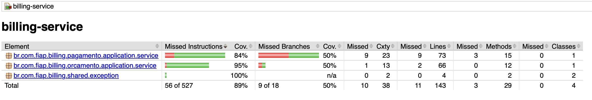

# oficina-billing-service

**FIAP Pós-Tech Software Architecture — Tech Challenge Fase 4**

Microsserviço responsável pela **geração de orçamentos**, **integração com Mercado Pago** e **controle de pagamentos** das Ordens de Serviço.

---

## Documentação de Arquitetura

Para diagramas detalhados (componentes, sequência, MongoDB schema, Hexagonal, Mercado Pago integration, Saga flows) consulte:

**[docs/ARQUITETURA.md](docs/ARQUITETURA.md)**

---

## Arquitetura

```
┌──────────────────────────────────────────────────────┐
│                billing-service (:8082)               │
│                                                      │
│  adapter/in/web  →  application/service  →  domain  │
│       ↕                    ↕                         │
│  adapter/out/persistence  adapter/out/messaging      │
│       ↕                    ↕                         │
│     MongoDB             RabbitMQ                     │
│       ↕                                              │
│   Mercado Pago API                                   │
└──────────────────────────────────────────────────────┘
```

**Padrão:** Arquitetura Hexagonal (Ports & Adapters) + DDD

**Banco:** MongoDB (não relacional — orçamentos e pagamentos têm estrutura flexível, sem FK para outros serviços)

---

## Tecnologias

| Tecnologia | Versão |
|---|---|
| Java | 17 |
| Spring Boot | 3.5.3 |
| MongoDB | 7 |
| RabbitMQ | 3 |
| Mercado Pago SDK | — |
| JaCoCo | 80% mínimo |

---

## Saga Pattern — Participante

Este serviço é **participante** do Saga Pattern coreografado. Reage ao evento `os.aberta` criando o orçamento e ao evento `orcamento.solicitado` atualizando os itens. Publica `orcamento.gerado`, `pagamento.confirmado` e `pagamento.recusado`.

### Papel no fluxo

```
OS Service publica os.aberta
  → Billing cria orçamento inicial no MongoDB
  → publica: orcamento.gerado

OS Service publica orcamento.solicitado
  → Billing atualiza orçamento com itens/peças
  → publica: orcamento.gerado (atualizado)

Admin inicia pagamento via POST /api/billing/pagamentos
  → Billing cria preferência no Mercado Pago
  → Mercado Pago chama webhook

Webhook recebido (pagamento aprovado)
  → publica: pagamento.confirmado

Webhook recebido (pagamento recusado)
  → publica: pagamento.recusado (rollback saga)
```

---

## Endpoints

### Orçamentos (requerem JWT)
| Método | Path | Descrição |
|--------|------|-----------|
| POST | `/api/billing/orcamentos` | Criar orçamento manualmente |
| GET | `/api/billing/orcamentos/{osId}` | Consultar orçamento por OS |

### Pagamentos
| Método | Path | Descrição |
|--------|------|-----------|
| POST | `/api/billing/pagamentos` | Iniciar pagamento (Mercado Pago) |
| GET | `/api/billing/pagamentos/{osId}` | Status do pagamento |
| POST | `/api/billing/pagamentos/webhook` | Webhook Mercado Pago (público) |

---

## Eventos RabbitMQ

**Exchange:** `oficina.events` (TopicExchange)

### Publica
| Routing Key | Quando |
|-------------|--------|
| `orcamento.gerado` | Orçamento criado ou atualizado |
| `pagamento.confirmado` | Pagamento aprovado pelo Mercado Pago |
| `pagamento.recusado` | Pagamento recusado (rollback saga) |

### Consome
| Routing Key | Ação |
|-------------|------|
| `os.aberta` | Cria orçamento inicial |
| `orcamento.solicitado` | Atualiza orçamento com itens detalhados |

---

## Testes

### Unitários (JUnit 5 + Mockito)
```bash
./mvnw test
```

### Cobertura JaCoCo (mínimo 80%)
```bash
./mvnw verify
# Relatório: target/site/jacoco/index.html
```



| Pacote | Instruções | Branches | Linhas |
|--------|-----------|----------|--------|
| pagamento.application.service | 84% | 50% | 73 |
| orcamento.application.service | 95% | 50% | 66 |
| shared.exception | 100% | n/a | 4 |
| **Total** | **89%** | **50%** | **143** |

---

## Executar localmente

```bash
# Subir MongoDB + RabbitMQ
docker compose up -d

# Rodar aplicação
./mvnw spring-boot:run

# Swagger UI
http://localhost:8082/swagger-ui.html
```

### Variável obrigatória

Configure o access token do Mercado Pago:
```bash
export MERCADOPAGO_ACCESS_TOKEN=seu_token_aqui
```

---

## CI/CD

Pipeline: **build-test → sonar → docker → deploy**

O job `docker` só executa se `build-test` **e** `sonar` passarem.

Secrets necessários: `DOCKER_USERNAME`, `DOCKER_PASSWORD`, `KUBECONFIG`, `SONAR_TOKEN`

---

## Infraestrutura Kubernetes

```
k8s/
├── namespace.yaml   — namespace oficina
├── secret.yaml      — credenciais (MongoDB, JWT, Mercado Pago)
├── configmap.yaml   — variáveis de ambiente
├── deployment.yaml  — app + MongoDB
└── hpa.yaml         — HorizontalPodAutoscaler (2–10 réplicas)
```
