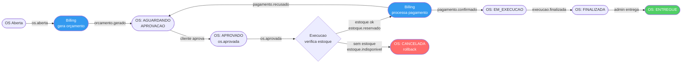
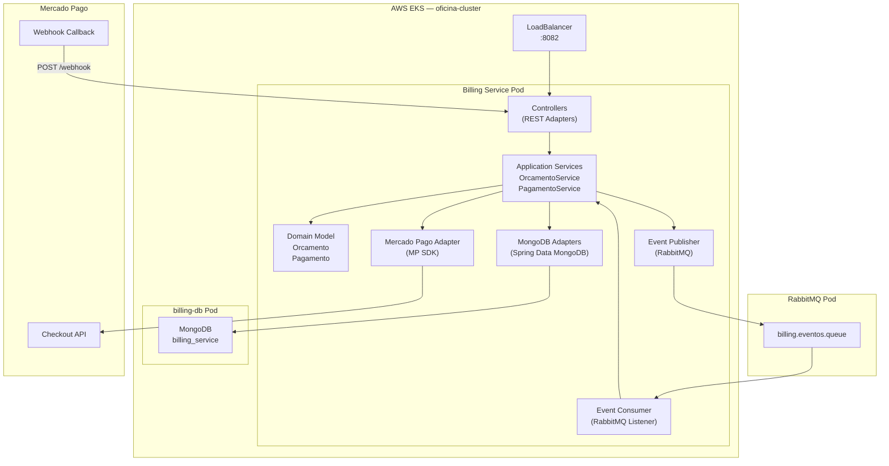
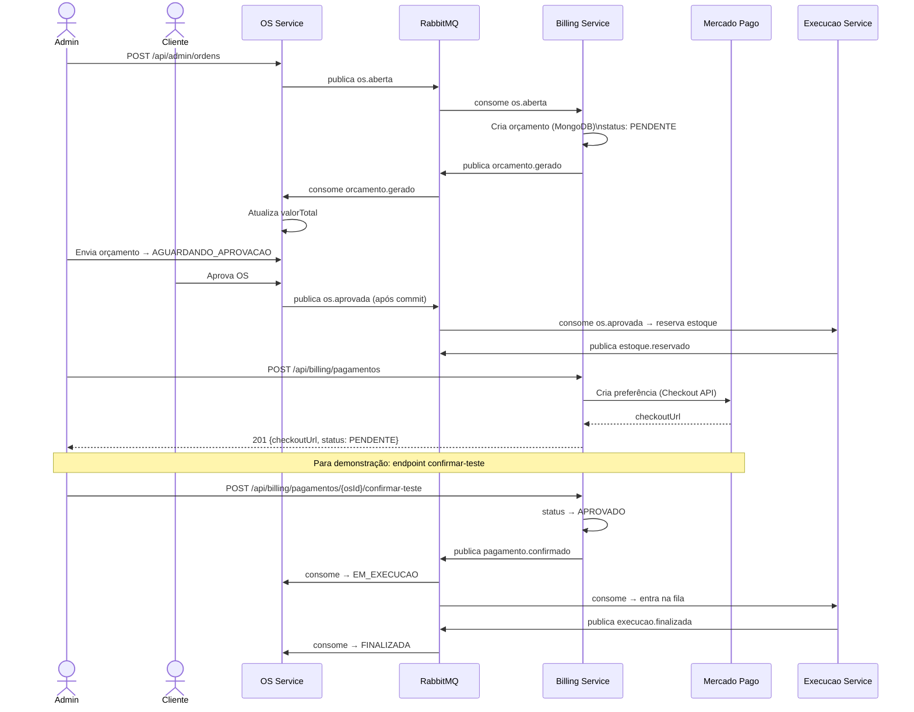
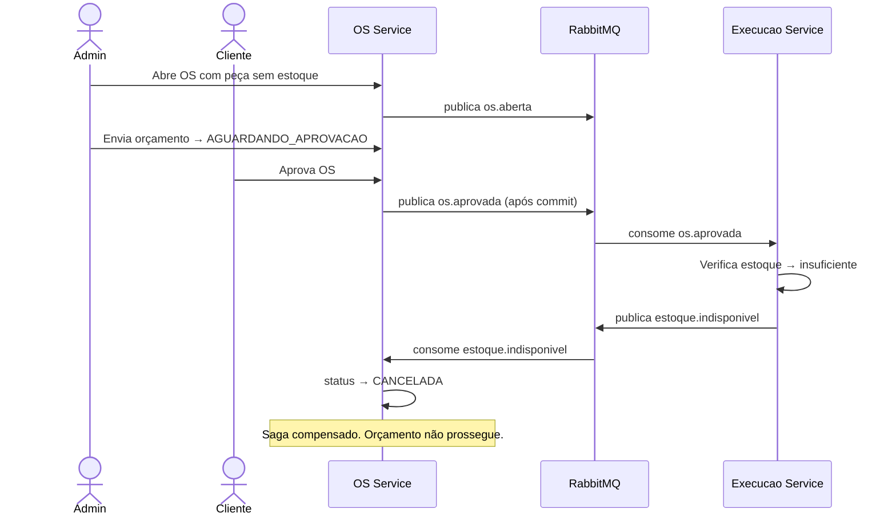
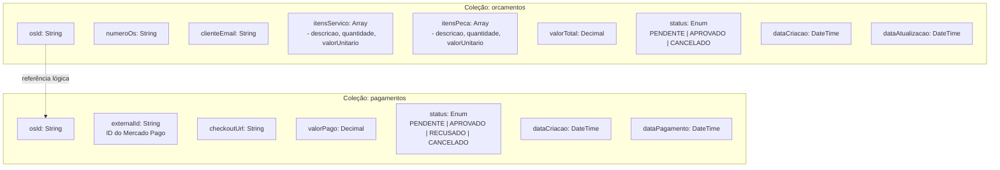
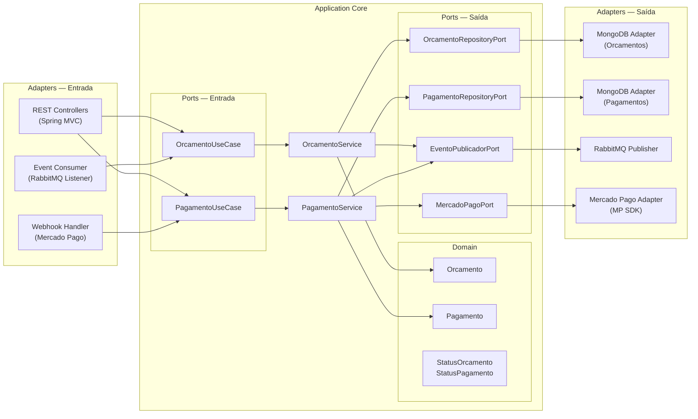
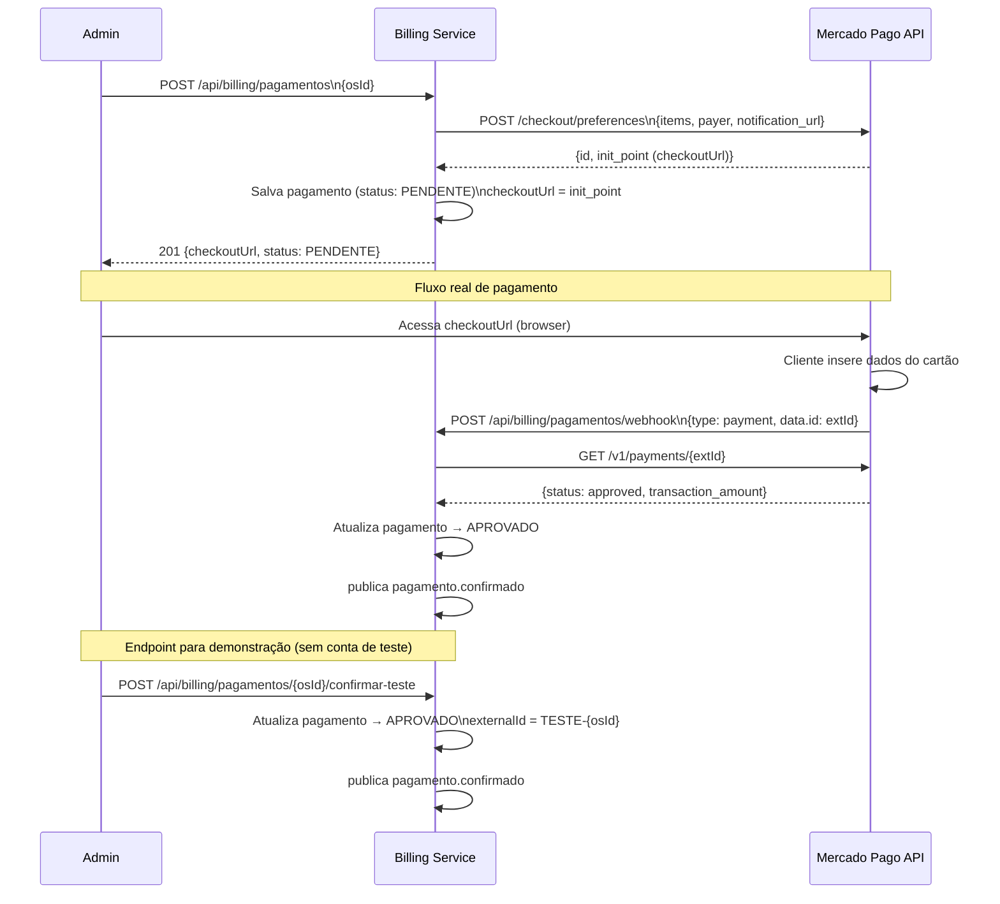

# Documentação de Arquitetura — Billing Service
## FIAP Pós-Tech Software Architecture — Tech Challenge Fase 4

---

## Sumário

1. [Visão Geral do Serviço](#1-visão-geral-do-serviço)
2. [Arquitetura da Fase 4 — Microsserviços](#2-arquitetura-da-fase-4--microsserviços)
3. [Diagrama de Componentes do Serviço](#3-diagrama-de-componentes-do-serviço)
4. [Diagrama de Sequência — Saga Happy Path](#4-diagrama-de-sequência--saga-happy-path)
5. [Diagrama de Sequência — Saga Rollback](#5-diagrama-de-sequência--saga-rollback)
6. [Modelo de Dados (MongoDB)](#6-modelo-de-dados-mongodb)
7. [Arquitetura Hexagonal](#7-arquitetura-hexagonal)
8. [Integração Mercado Pago](#8-integração-mercado-pago)
9. [Eventos Publicados e Consumidos](#9-eventos-publicados-e-consumidos)
10. [Justificativa do Banco de Dados](#10-justificativa-do-banco-de-dados)
11. [ADRs](#11-adrs)

---

## 1. Visão Geral do Serviço

O **Billing Service** é responsável pela geração de orçamentos e processamento de pagamentos das Ordens de Serviço. Integra com o Mercado Pago para geração de links de pagamento e processa callbacks via webhook.

| Atributo | Valor |
|---|---|
| Linguagem | Java 17 |
| Framework | Spring Boot 3.5.3 |
| Banco de Dados | MongoDB |
| Mensageria | RabbitMQ (produtor e consumidor) |
| Porta | 8082 |
| Integração externa | Mercado Pago SDK |

### Responsabilidades

- Geração de orçamentos a partir de eventos `os.aberta`
- Criação de preferências de pagamento no Mercado Pago
- Processamento de webhooks de confirmação de pagamento
- Publicação de `pagamento.confirmado` para liberar execução da OS

---

## 2. Arquitetura da Fase 4 — Microsserviços

Diagrama completo da comunicação entre os 3 microsserviços via RabbitMQ (Exchange: `oficina.events`).

```mermaid
graph TB
    subgraph Cliente["Atores Externos"]
        ADM[Admin / Atendente]
        CLI[Cliente]
        MP[Mercado Pago\nWebhook]
    end

    subgraph RMQ["RabbitMQ — oficina.events (Topic Exchange)"]
        direction LR
        E1([os.aberta])
        E2([os.aprovada])
        E3([os.cancelada])
        E4([orcamento.gerado])
        E5([pagamento.confirmado])
        E6([pagamento.recusado])
        E7([estoque.reservado])
        E8([estoque.indisponivel])
        E9([execucao.finalizada])
    end

    subgraph OS["OS Service — :8080\nPostgreSQL"]
        OS_API[REST API]
        OS_CON[Event Consumer]
        OS_PUB[Event Publisher]
    end

    subgraph BILLING["Billing Service — :8082\nMongoDB"]
        B_API[REST API]
        B_CON[Event Consumer]
        B_PUB[Event Publisher]
    end

    subgraph EXEC["Execucao Service — :8081\nPostgreSQL"]
        EX_API[REST API]
        EX_CON[Event Consumer]
        EX_PUB[Event Publisher]
    end

    ADM -->|JWT Bearer| OS_API
    CLI -->|endpoint público| OS_API
    MP -->|webhook| B_API
    ADM -->|JWT Bearer| B_API

    OS_PUB -->|publica| E1
    OS_PUB -->|publica| E2
    OS_PUB -->|publica| E3

    E1 -->|consome| B_CON
    E2 -->|consome| EX_CON
    E3 -->|consome| EX_CON

    B_PUB -->|publica| E4
    B_PUB -->|publica| E5
    B_PUB -->|publica| E6

    E4 -->|consome| OS_CON
    E5 -->|consome| OS_CON
    E5 -->|consome| EX_CON
    E6 -->|consome| OS_CON

    EX_PUB -->|publica| E7
    EX_PUB -->|publica| E8
    EX_PUB -->|publica| E9

    E7 -->|consome| OS_CON
    E8 -->|consome| OS_CON
    E9 -->|consome| OS_CON
```

### Fluxo do Saga Pattern (Coreografado)

---

## 3. Diagrama de Componentes do Serviço

---

## 4. Diagrama de Sequência — Saga Happy Path

---

## 5. Diagrama de Sequência — Saga Rollback

---

## 6. Modelo de Dados (MongoDB)

**Nota:** Não há FK entre coleções. A correlação é feita via `osId` (UUID da OS), que é a chave de ligação com o OS Service.

---

## 7. Arquitetura Hexagonal

---

## 8. Integração Mercado Pago

**Nota sobre o endpoint `confirmar-teste`:** O Mercado Pago exige contas de teste separadas para comprador e vendedor. Como o ambiente de desenvolvimento usa a conta produtiva do desenvolvedor, foi criado este endpoint auxiliar exclusivamente para demonstração acadêmica, que simula a confirmação sem passar pelo fluxo real de pagamento.

---

## 9. Eventos Publicados e Consumidos

### Publica

| Routing Key | Trigger | Payload principal |
|---|---|---|
| `orcamento.gerado` | Orçamento criado/atualizado | osId, numeroOs, valorTotal |
| `pagamento.confirmado` | Webhook aprovado ou confirmar-teste | osId, externalId, valorPago |
| `pagamento.recusado` | Webhook recusado | osId, motivo |

### Consome

| Routing Key | Origem | Ação |
|---|---|---|
| `os.aberta` | OS Service | Cria orçamento inicial no MongoDB |

---

## 10. Justificativa do Banco de Dados

**MongoDB** foi escolhido para o Billing Service pelos seguintes motivos:

- Orçamentos têm estrutura variável: arrays de itens de serviço e peças com diferentes atributos
- Dados de pagamento incluem metadados do Mercado Pago com estrutura flexível
- Sem necessidade de JOINs — cada documento é auto-contido
- Alta velocidade de leitura/escrita para processamento de webhooks
- Atende ao requisito obrigatório de **banco NoSQL** na arquitetura

---

## 11. ADRs

### ADR-001: MongoDB como Banco de Dados

**Status:** Aceito

**Contexto:** O Billing Service precisa armazenar orçamentos com estrutura de itens variável e dados de pagamento do Mercado Pago.

**Decisão:** Usar MongoDB como banco de dados principal do Billing Service.

**Justificativa:**
- Documentos JSON se alinham naturalmente com a estrutura de orçamentos e payloads do Mercado Pago
- Flexibilidade de schema para campos opcionais do webhook
- Atende ao requisito de banco NoSQL da Fase 4

---

### ADR-002: Endpoint `confirmar-teste` para Demonstração

**Status:** Aceito

**Contexto:** A integração com Mercado Pago em ambiente de testes requer contas de teste separadas para comprador e vendedor. A API de criação de contas de teste não está disponível com token de aplicação produtiva.

**Decisão:** Implementar endpoint `POST /api/billing/pagamentos/{osId}/confirmar-teste` que confirma o pagamento sem passar pelo Mercado Pago, publicando diretamente o evento `pagamento.confirmado`.

**Consequências:**
- Permite demonstração do fluxo completo da Saga sem dependência de contas de teste
- O link do Mercado Pago é gerado normalmente e pode ser exibido como evidência da integração
- O endpoint é protegido por autenticação JWT (admin apenas)
